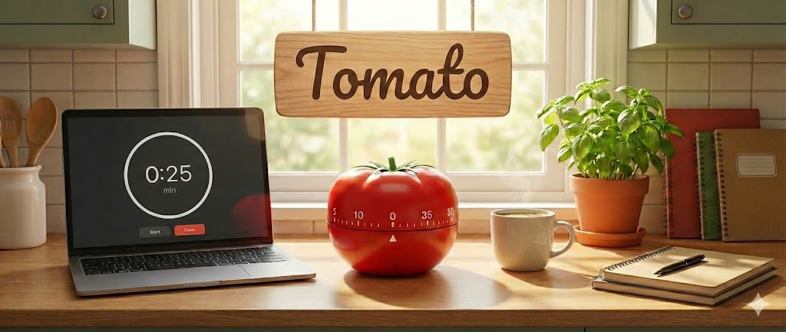
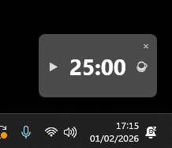
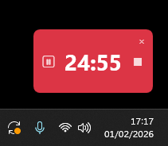
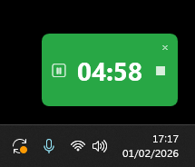
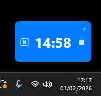
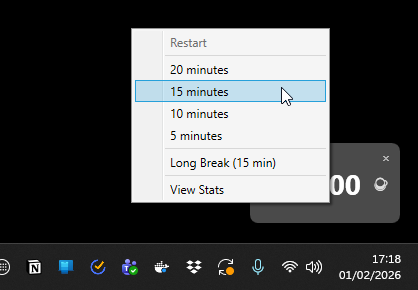
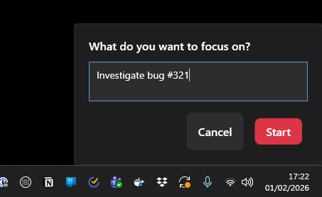
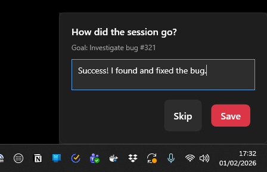
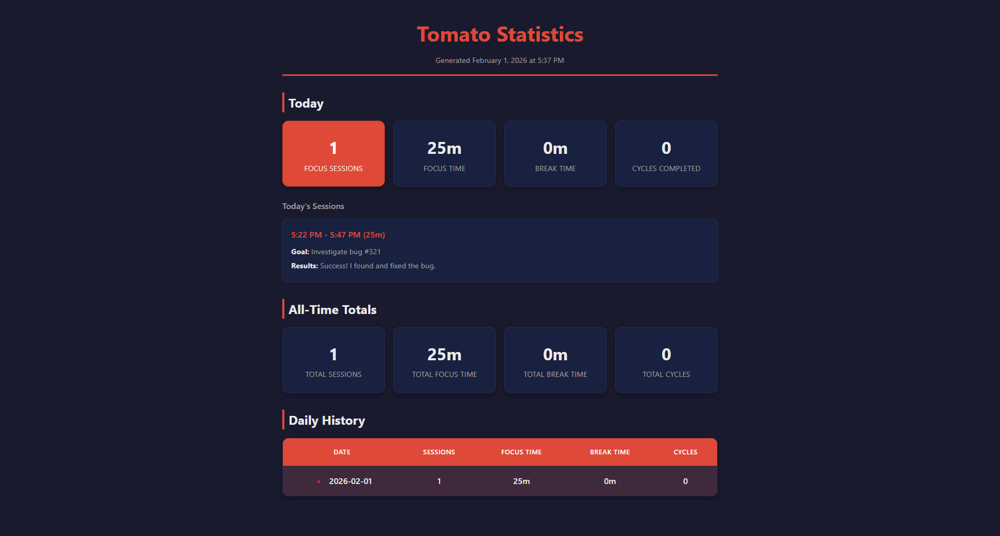

# Tomato

A minimal Windows desktop Pomodoro timer.



## Features

- 25-minute focus sessions with short and long breaks
- 4-session cycles (Focus → Break → Focus → Break → Focus → Break → Focus → Long Break). Every focus session counts as one, whatever its length
- Estimates: set how long a focus session should take (1-120 minutes) when you start it - see [Estimates and Overtime](#estimates-and-overtime)
- Optional Overtime: keep a focus session going past its Estimate until you mark it done
- Done (✓ button, right-click or tray menu): finish a focus session early, or end its Overtime, and record the time actually spent
- Custom-length sessions from the right-click or tray menu: 5/10/15/20-minute focus or Custom..., a 10-minute break, or a 15-minute long break
- Goal setting dialog when starting a focus session
- Quick-capture todos during focus sessions (right-click menu)
- Results dialog when a focus session completes (includes captured todos)
- Session statistics tracking with historical data
- View Stats report (right-click → View Stats) - generates an HTML report with:
  - Today's stats (sessions, focus time, break time, cycles)
  - Today's individual sessions with goals, results and how the time spent compared with the Estimate
  - All-time totals
  - Daily history with expandable session details
- Sound notifications on session completion
- State persistence across restarts (a session running when the app closes is restored as paused)
- Compact, always-on-top window
- System tray icon with color-coded session state and context menu
- Slack integration - automatically sets status and enables Do Not Disturb during focus sessions

## Screenshots

### Non-intrusive always-on-top display






### Custom times



### Pomodoro goal and feedback entry




### Estimates and Overtime

Every focus session starts from the goal dialog, which also asks for an **Estimate**: how many minutes (1-120) you expect the goal to take. It's filled in from whatever you clicked: 25 for Start, the preset for 5/10/15/20 minutes, and for **Custom...** the cursor goes straight to the Estimate so you can type a number.

Click **Done** (the ✓ button, or Done in the right-click or tray menu) when you've finished. The session is recorded with the time you actually spent, not counting pauses, so finishing a 30-minute Estimate in 18 minutes records 18 minutes. Focus time totals in the stats use the time actually spent.

**Overtime** is off by default. Turn it on with the Overtime item in the right-click or tray menu (it's remembered across restarts, and takes effect from the next focus session). With Overtime on, when the Estimate runs out the completion sound plays once and the timer keeps counting below zero (`-04:12`), with the window and tray icon turning amber, until you click Done. With it off, the session ends when the Estimate runs out, as before.

When a focus session ends, the results dialog and the stats report show how it went, for example "Estimated 15m, took 18m (3m over)". Sessions recorded before Estimates existed show no comparison.

### Quick-capture todos

During a focus session, right-click and select "Add Todo" to quickly capture a thought or task. Todos are displayed:
- When the session completes normally (in the feedback dialog)
- When you stop a session early that has captured todos (in a dedicated todos dialog)

Todos are formatted as markdown checkboxes for easy copy/paste:

```markdown
- [ ] Buy groceries
- [ ] Call mom
- [ ] Review PR
```

Todos are temporary and cleared after you start a new focus session.

### Report generation



## Slack Integration

Tomato can automatically update your Slack status and enable Do Not Disturb when you start a focus session.

### Setup

1. Create a Slack App at [api.slack.com/apps](https://api.slack.com/apps)
2. Add the following OAuth scopes under "User Token Scopes":
   - `users.profile:write` - to set your status
   - `dnd:write` - to enable Do Not Disturb
3. Install the app to your workspace and copy the "User OAuth Token" (starts with `xoxp-`)
4. Run `Tomato.exe --setup-slack` and paste your token
5. Click "Test Connection" to verify it works, then "Save"

### Behavior

- **Focus session starts or resumes**: Status changes to 🍅 "Focus time" and DND is enabled, both set to expire when the session would end
- **Overtime**: there's no known end, so the status and DND are set for 10 minutes at a time and extended before they run out, until you click Done
- **Focus session is paused, ends, or the app exits**: Status is cleared and DND is disabled
- **Breaks**: No changes to Slack status

Your token is stored encrypted using Windows DPAPI at `%LOCALAPPDATA%\Tomato\slack.json`. If Slack rejects an update, the reason is written to `%LOCALAPPDATA%\Tomato\error.log`.

## Saved data

Tomato keeps its data in `%LOCALAPPDATA%\Tomato`:

- `state.json`: the current session, cycle progress, all statistics history and whether Overtime is on. A session running when the app closes is saved as paused, so you can resume it next time (a session in Overtime comes back still in Overtime).
- `error.log`: unexpected errors, and Slack updates that were rejected. It starts a new file once it passes 1 MB.
- `slack.json` / `luxafor.json`: integration settings, encrypted with Windows DPAPI.

To avoid losing history:

- `state.json` is written to a temporary file first and then swapped in, so a crash or power cut during a save can't leave it half-written.
- If `state.json` can't be read as valid data, it's renamed to `state.corrupt-<date>-<time>.json` (so the history in it can be recovered by hand) and the app starts with no history.
- If `state.json` exists but is locked by another program (for example antivirus or a sync client) when Tomato starts, Tomato starts with no history and doesn't save anything until it's restarted, so the file isn't overwritten. Sessions from that run aren't kept.

## Download

Download the latest release from the [Releases](https://github.com/dracan/tomato/releases) page.

Extract the zip and run `Tomato.exe`.

## Building from Source

Requires [.NET 10.0 SDK](https://dotnet.microsoft.com/download/dotnet/10.0).

```bash
dotnet build Tomato.sln
dotnet run --project Tomato/Tomato.csproj
```

## Running Tests

```bash
dotnet test Tomato.sln
```
